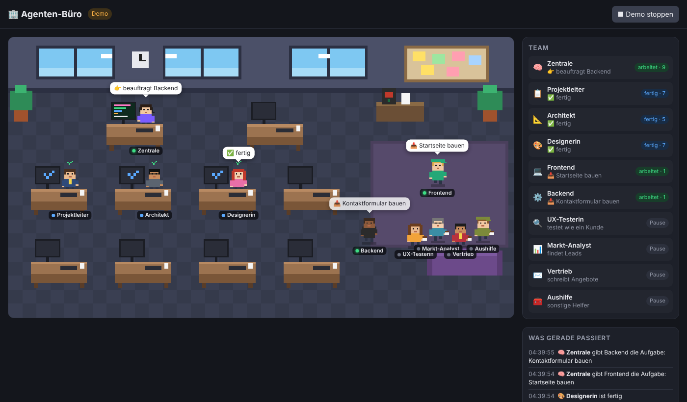

# 🏢 Agenten-Büro

Dein Agententeam als Pixel-Büro: Jeder Agent hat einen Schreibtisch. Wenn er einen Auftrag bekommt,
läuft er aus der Kaffeeecke an seinen Platz, tippt, und eine Sprechblase zeigt, was er gerade macht
(z. B. „schreibt PLAN.md“, „recherchiert: Bäckerei Webseiten“). Wer fertig ist, bekommt einen Haken
und geht nach einer Weile zurück in die Pause.

## So startest du es (Windows)

1. Einmalig: [Node.js LTS](https://nodejs.org) installieren (falls noch nicht da).
2. Doppelklick auf `buero/start.bat`. Der Browser öffnet sich mit `http://localhost:4321`.
   Das schwarze Fenster offen lassen.
3. In einem zweiten Fenster im Repo-Ordner Claude Code starten (`claude`) und z. B.
   `/auftrag Webseite für Bäckerei Müller in Köln` eingeben.
4. Zuschauen. 🙂

Ohne laufende Agenten kannst du oben rechts auf **Demo abspielen** klicken.

Mac/Linux: `./buero/start.sh`

## Wie es funktioniert

- `.claude/settings.json` meldet Claude Code bei jeder Aktion an `buero/hook.js`
  (Auftrag kommt rein, Agent startet, Datei lesen/schreiben, Websuche, Agent fertig).
- `hook.js` schreibt eine kurze Zeile nach `buero/events.jsonl` (wird nicht committet).
  Lange Zeichenketten und `token=…`/`key=…` werden dabei ausgeblendet, damit keine Secrets im Log landen.
- `server.js` (ohne Zusatzpakete) liefert die Seite aus und schickt neue Zeilen live an den Browser.

Neuer Agent in `.claude/agents/`? Dann in `public/index.html` oben in `TEAM` und `DESKS` einen Eintrag
ergänzen. Bis dahin sitzt er als „Aushilfe“ am freien Tisch.

## Hinweis zu Cloud-Sitzungen

Das Büro zeigt die Agenten, die auf **deinem PC** laufen. Aufträge, die du in der Claude-App in der Cloud
startest, laufen auf einem fremden Rechner; die sieht dein lokales Büro nicht.
